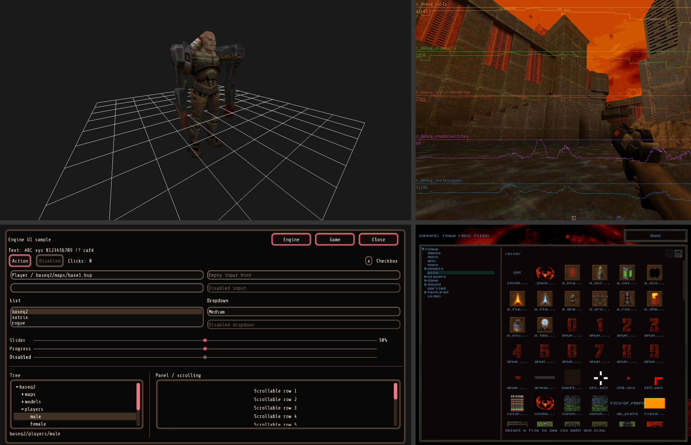

# Jake2 & Cake




Welcome to the Jake2 and Cake game engine repository.

Jake2 is a Java source port of the Quake II engine. Cake is its modern
Kotlin/libGDX client and desktop application layer, providing interfaces for
playing, hosting, and exploring game content.

Both projects are developed together in this repository: Jake2 provides the
server, gameplay, and shared engine code; Cake provides the new client, desktop
applications, and content viewer.

[Screenshots](info/screenshots/Screenshots.md)

The projects build on id Software's Quake II engine and content formats, with
ongoing work to modernize the codebase and expand its use for game development
and tooling. Development is active; bug reports and contributions are welcome.

Distributed under the [GNU General Public License](LICENSE).

## What's included

| Component | What it provides |
| --- | --- |
| **Jake2 engine** | Shared engine code, server runtime, and Quake II gameplay implementation. See the [architecture overview](info/Overview.md). |
| **Cake Fullgame** | Desktop application for singleplayer, connecting to multiplayer servers, and hosting games. |
| **Cake Client** | Desktop application for connecting to remote multiplayer servers. |
| **Cake Viewer** | Standalone content browser for inspecting maps, models, images, sounds, and other game resources. See the [viewer guide](info/cake-viewer.md). |
| **Dedicated server** | Server application for hosting games without a graphical client. |
| **Map tools(WIP)** | Command-line BSP inspection and cataloging tools. See the [map tools guide](maptools/README.md). |

Start with **Cake Fullgame** to play or host games. Use **Cake Client** when you
only need to connect to a remote server, or **Cake Viewer** to explore content
without starting a game. See the [Cake guide](cake/README.md) for application
setup and usage.

## Quick start

You can download precompiled binaries for your platform (Linux/Windows/MacOS) in the releases.

### Build and test

Install **JDK 25** and run these commands from the repository root. On Windows,
use `gradlew.bat` instead of `./gradlew`.


```sh
./gradlew build
```

Building and running tests does not require Quake II game data.

### Run Cake Fullgame

```sh
./gradlew :cake:cake-fullgame:run
```

Playing requires separately supplied Quake II game data; it is not included in
this repository. Cake attempts to detect a Steam installation on first launch.
If no usable profile is found, it opens the profile editor so you can configure
your game-data location.  See [game-data setup](cake/README.md#game-data-and-profiles) for manual configuration.

### Run the dedicated server

See the [dedicated server guide](dedicated/README.md) for installation, launch,
and console commands.

### Other applications

See the [Cake guide](cake/README.md#building-and-running) for desktop packages,
IDE entry points, and native builds, or the [viewer guide](info/cake-viewer.md)
for supported resources and controls. JVM distributions require Java 25 or newer;
application images built with `jpackage` include Java.

## Content and compatibility

Jake2 and Cake use Quake II content formats and the classic **protocol 34** for
multiplayer. Interoperability with other Quake II clients and servers depends on
their support for that protocol and the required game content.

Custom maps and assets can be used within the supported formats. Native gameplay
modules such as `game.dll` and `game.so` cannot be loaded: Jake2's gameplay runs
on the JVM, so mods requiring custom native logic need a port.

See the [compatibility guide](info/Compatibility.md) for content formats, packages,
demo support, and limitations.

## Documentation

| Start here | Guide |
| --- | --- |
| Play, host, or package the desktop applications | [Cake guide](cake/README.md) |
| Configure game data and mods | [Profiles and game data](cake/README.md#game-data-and-profiles) |
| Browse and preview content | [Cake Viewer](info/cake-viewer.md) |
| Inspect BSP maps from the command line | [Map tools](maptools/README.md) |
| Understand the engine and gameplay boundaries | [Architecture overview](info/Overview.md) |
| Work on multiplayer networking | [Networking](info/Networking.md) |
| Understand asset lookup and package precedence | [Virtual filesystem](info/vfs.md) |
| Work on Cake rendering and asset loading | [Asset pipeline](cake/core/src/main/kotlin/org/demoth/cake/assets/README.md) |
| Generate fonts and application artwork | [Asset tools](cake/asset-tools/README.md) |

## Project direction

Jake2 and Cake are hobby projects with a shared aim: keep the engine usable on
modern systems while making it easier to understand, extend, and build with (and have fun!).

The longer-term ambition is to support new games and a broader set of development
tools on these foundations. See the [roadmap](info/Roadmap.md) for current
foundations, areas for further work, and exploratory ideas.

## Contributing

Bug reports, documentation improvements, and code contributions are welcome.
Use this repository's GitHub issue tracker for bugs and feature discussions.
Testing Cake with custom mods/maps is a good way to verify expected compatibility.

For engine and gameplay changes, start with the [architecture overview](info/Overview.md).
For client and application changes, start with the [Cake guide](cake/README.md).
Build and run the tests with `./gradlew build`; individual modules can be checked
with tasks such as `./gradlew :qcommon:test` or `./gradlew :maptools:test`.

## License and credits

Jake2 derives from id Software's Quake II engine. The project is distributed under
the [GNU General Public License, version 2](LICENSE). Quake II game data is
separately licensed and is not included.

Daniil Bubnov (demoth) maintains Jake2 (2019–present). The original Java port was developed
by bytonic Software (2003–2015). See [Authors and contributors](AUTHORS.md) for
individual credits.
