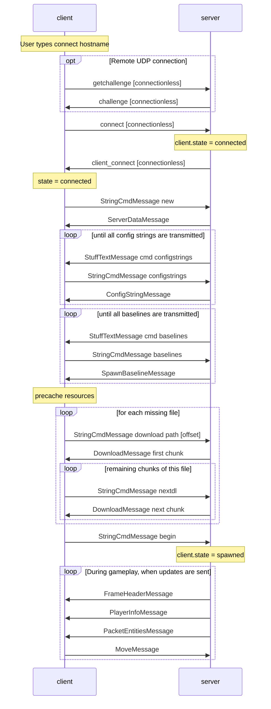

# Quake 2 Networking Communication Protocol

## Glossary

- **Owner** — The client or server responsible for creating and closing its network resources.
- **Transport** (`NetworkTransport`) — Sends and receives datagrams through the owner's local and UDP endpoints.
- **Endpoint** (`DatagramEndpoint`) — One place where datagrams are sent and received: a UDP socket or a local queue.
- **Local link** (`LoopbackLink`) — A private pair of endpoints connecting a client and server inside one process.
- **Network** (`ClientNetwork` / `ServerNetwork`) — The application's interface for configuring network I/O, polling packets, and creating connections.
- **Packet network** (`PacketNetwork`) — Shared client/server implementation of binding, polling, and packet-envelope decoding.
- **Connection** (`ConnectionChannel`) — Communication with one peer, including its address and queued outgoing messages.
- **Reliable channel** (`ReliableChannel`) — Tracks packet sequences, acknowledgements, and reliable retransmissions for one connection.
- **Address** (`NetworkAddress`) — Identifies a UDP IP/port or an endpoint on a specific local link.
- **Datagram** — One independently delivered unit of bytes, together with its source address when received.
- **Packet** — A Quake II protocol unit carried by a datagram; either connectionless or sequenced.
- **Envelope** (`PacketEnvelope`) — The decoded outer packet structure, identifying its kind and header fields.
- **Message** (`ClientMessage` / `ServerMessage`) — One command or update inside a sequenced packet, such as movement or entity state.
- **Codec** — Converts protocol values to and from bytes; it does not own sockets or connections.
- **Handshake** (`ClientHandshake`) — The exchange used to establish a connection, including challenges and retries.
- **Session** — The lifetime of a connection to a server; it can span multiple map changes.

## Transport ownership

- Client and server each own a separate transport.
- Each transport manages an optional UDP socket (optional, for multiplayer) and one endpoint of the local link (singleplayer and local hosting).
- Stopping or closing one side preserves messages already queued for the other side.
- Map changes preserve reconnect traffic; clearing both local queues requires an explicit session-level decision.

## NetworkPacket

`NetworkPacket` adapts a received datagram for the engine. `PacketCodec` identifies
two packet types, represented by `PacketEnvelope.Sequenced` and
`PacketEnvelope.Connectionless`.

### Sequenced packets

These carry communication over an established game connection:

- **Header:** sequence and acknowledgement fields, plus a qport on client-to-server packets.
- **Body:** zero or more typed `ClientMessage` or `ServerMessage` values, such as movement, player state, or entity updates.
- **Handling:** peer routing and `ReliableChannel` acceptance, followed by message-body decoding and dispatch.

`MessageBodyCodec` validates the whole body before dispatch, returning all messages
or a typed rejection. Malformed bodies cause the server to drop the sending client,
or the receiving client to return to its console. A failed movement checksum makes
the server ignore the rest of the packet. File/demo readers retain their existing
`sizebuf_t` behavior.

### Connectionless (out-of-band) packets

These are independent datagrams that can be sent by connected or unconnected peers,
without requiring a running map:

- **Marker:** a leading sequence value of -1 identifies a connectionless packet.
- **Payload:** text commands and replies, such as `getchallenge`, `connect`, `ping`, and `print`, described by `ConnectionlessCommand`.
- **Handling:** connectionless command or handshake handlers, bypassing `ReliableChannel` and `MessageBodyCodec`. Handshake retries are managed by `ClientHandshake`.

For server `info` and `print` replies, a newline separates the command line from the
remaining reply text; these are not two separately encoded strings.

Outgoing packets are built as bytes. Sending depends on connection state, rate
limiting, and keepalive or handshake timing, rather than occurring on every frame
on both sides.

## Reliability
Remote communication uses UDP; in-process communication uses `LoopbackLink`.
Both use the Quake II packet protocol and its reliability machinery.
When reliable data is ready to send or retransmit, it goes first, followed by the
unreliable batch if there is room. A packet can also contain only its header.

The entry point is `ConnectionChannel.transmit`; protocol state is managed by
`ReliableChannel`. Sequence and acknowledgement fields track reliable delivery;
a dropped reliable payload is resent when acknowledgement state indicates a retry is needed.

## Delta compression

The bulk of the network traffic between server & client constitute entity updates and move messages.
To reduce traffic, the Quake II protocol uses delta compression: sending selected fields relative to a reference state, rather than always sending the complete state.
The following messages use delta compression:

 1. `PlayerInfoMessage` (from server)
 2. `PacketEntitiesMessage` (from server)
 3. `MoveMessage` (from client)

The reference depends on the message:

- Player state uses a client-acknowledged frame when available, otherwise a zero state.
- Entity updates use the acknowledged frame for existing entities and baselines for newly visible entities.
- Movement sends three commands as a delta chain: the oldest against a zero command, then each later command against the preceding one.

Field masks identify what is transmitted. Some fields are sent even when unchanged;
for example, movement commands always include their duration and light level.
Player-state updates send the weapon index only when it differs from the reference state,
including changes to zero.

## Server Messages
see package `jake2.qcommon.network.messages.server`

## Client Messages
see package `jake2.qcommon.network.messages.client`

## Client States
see jake2.server.ClientStates

# Connection initialization
The following diagram illustrates client/server communication when client connects to server.
Starting from typing connect 'someaddress' and until client becomes connected and receives the updates from the server. 

