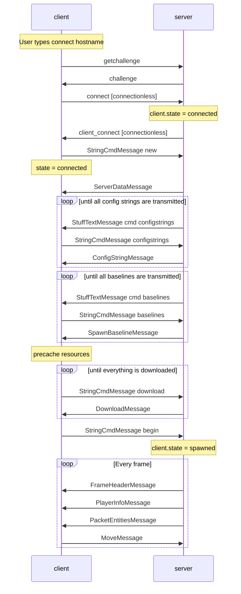

# Quake 2 Networking Communication Protocol

## Transport ownership

Client and server controllers own separate `NetworkTransport` instances. Each role
configures only its own UDP endpoint; loopback communication needs no socket. A
client may fall back to an ephemeral UDP port when its configured port is occupied.
Applications compose these owners explicitly, replacing the former combined global
socket policy and `NET` facade. The archived client's API/ABI is not maintained;
the Quake II network wire protocol remains compatible.

Local traffic uses a private `LoopbackLink`. Session stop discards incoming local
traffic while preserving final messages already queued for the peer. Map changes
retain reconnect traffic; clearing both local queues belongs at a whole-session
boundary. Closing an owner closes its resources independently of the peer's.

Packet decoding has explicit, side-effect-free outcomes below the engine adapter.
Dedicated-server tick waiting currently uses a timed sleep rather than socket
readiness. Network ownership does not impose a global client/server sleep policy.

## NetworkPacket

Every frame both client and servers are sending a jake2.qcommon.network.messages.NetworkPacket to each other.
Each such packet contains a header and several (Client|Server)Messages

## "Connectionless" (Out of band) packet
Such packets/messages are sent ad-hoc and don't require a running map instance, therefore could be sent by not connected clients.
They are separate datagrams rather than messages inside a sequenced game-channel packet.
`PacketCodec` identifies them by their leading -1 sequence marker; the engine adapter can expose both kinds as `NetworkPacket` values.
Mostly such packets contain a single string (though there are some cases when 2 strings are sent - `info` & `print`)

see `jake2.qcommon.network.messages.ConnectionlessCommand`

## Reliability
Since quake2 utilizes only UDP protocol, reliability should be handled by the quake2 engine itself.
Each frame server tries to send a reliable message first, then if there is room append an unreliable buffer and send.

The implementation is `jake2.qcommon.network.netchan_t.transmit`. Sequence and
acknowledgement fields track reliable delivery; a dropped reliable payload is
resent, and unreliable data is included only when the packet has room.

## Delta compression

The bulk of the network traffic between server & client constitute entity updates and move messages.
In order to minimize the amount of information sent over the network quake2 protocol uses delta compression - an attempt to send only the difference from the previously sent command. 
The following messages use delta compression:

 1. `PlayerInfoMessage` (from server)
 2. `PacketEntitiesMessage` (from server)
 3. `MoveMessage` (from client)

The approach is the same for all of them - first identify what fields have changed (`deltaFlags`, like a bitmask), then sent only those fields.

## Server Messages
see package `jake2.qcommon.network.messages.server`

## Client Messages
see package `jake2.qcommon.network.messages.client`

## Client States
see jake2.server.ClientStates

# Connection initialization
The following diagram illustrates client/server communication when client connects to server.
Starting from typing connect 'someaddress' and until client becomes connected and receives the updates from the server. 

