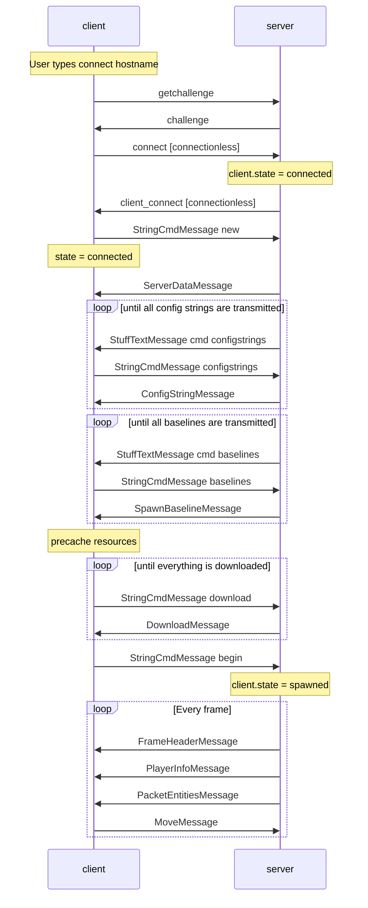

# Quake 2 Networking Communication Protocol

## Glossary

- **Owner** — The client or server responsible for creating and closing its network resources.
- **Transport** (`NetworkTransport`) — Sends and receives datagrams through the owner's local and UDP endpoints.
- **Endpoint** (`DatagramEndpoint`) — One place where datagrams are sent and received: a UDP socket or a local queue.
- **Local link** (`LoopbackLink`) — A private pair of endpoints connecting a client and server inside one process.
- **Network** (`ClientNetwork` / `ServerNetwork`) — The application's interface for configuring network I/O, polling packets, and creating connections.
- **Packet network** (`PacketNetwork`) — Shared client/server implementation of binding, polling, and packet-envelope decoding.
- **Connection** (`ConnectionChannel`) — Communication with one peer, including its address and queued outgoing messages.
- **Reliable channel** (`ReliableChannel`) — Tracks packet sequences, acknowledgements, and reliable retransmissions for one connection.
- **Address** (`NetworkAddress`) — Identifies a UDP IP/port or an endpoint on a specific local link.
- **Datagram** — One independently delivered unit of bytes, together with its source address when received.
- **Packet** — A Quake II protocol unit carried by a datagram; either connectionless or sequenced.
- **Envelope** (`PacketEnvelope`) — The decoded outer packet structure, identifying its kind and header fields.
- **Message** (`ClientMessage` / `ServerMessage`) — One command or update inside a sequenced packet, such as movement or entity state.
- **Codec** — Converts protocol values to and from bytes; it does not own sockets or connections.
- **Handshake** (`ClientHandshake`) — The exchange used to establish a connection, including challenges and retries.
- **Session** — The lifetime of a connection to a server; it can span multiple map changes.

## Transport ownership

- Client and server each own a separate transport.
- Each transport manages its own UDP socket and one endpoint of the local link.
- Stopping or closing one side preserves messages already queued for the other side.
- Map changes preserve reconnect traffic; clearing both local queues requires an explicit session-level decision.

## NetworkPacket

Every frame both client and servers are sending a jake2.qcommon.network.messages.NetworkPacket to each other.
Each such packet contains a header and several (Client|Server)Messages.

`MessageBodyCodec` decodes a sequenced payload with bounded reads before controllers
receive any messages. It returns either the complete collection or a typed rejection,
so a valid prefix of a structurally malformed packet cannot trigger application commands. Lengths,
opcodes, directions, and table indices are checked without global teardown from codecs.
The server drops the offending connection; the client returns to its console on a bad
server payload. Movement checksum validity keeps its existing `MoveMessage.valid`/controller policy.
Legacy file/demo readers keep their existing `sizebuf_t` behavior.

## "Connectionless" (Out of band) packet
Such packets/messages are sent ad-hoc and don't require a running map instance, therefore could be sent by not connected clients.
They are separate datagrams rather than messages inside a sequenced game-channel packet.
`PacketCodec` identifies them by their leading -1 sequence marker; the engine adapter can expose both kinds as `NetworkPacket` values.
Mostly such packets contain a single string (though there are some cases when 2 strings are sent - `info` & `print`)

see `jake2.qcommon.network.messages.ConnectionlessCommand`

## Reliability
Since quake2 utilizes only UDP protocol, reliability should be handled by the quake2 engine itself.
Each frame server tries to send a reliable message first, then if there is room append an unreliable buffer and send.

The implementation is `jake2.qcommon.network.netchan_t.transmit`. Sequence and
acknowledgement fields track reliable delivery; a dropped reliable payload is
resent, and unreliable data is included only when the packet has room.

## Delta compression

The bulk of the network traffic between server & client constitute entity updates and move messages.
In order to minimize the amount of information sent over the network quake2 protocol uses delta compression - an attempt to send only the difference from the previously sent command. 
The following messages use delta compression:

 1. `PlayerInfoMessage` (from server)
 2. `PacketEntitiesMessage` (from server)
 3. `MoveMessage` (from client)

The approach is the same for all of them - first identify what fields have changed (`deltaFlags`, like a bitmask), then sent only those fields.

## Server Messages
see package `jake2.qcommon.network.messages.server`

## Client Messages
see package `jake2.qcommon.network.messages.client`

## Client States
see jake2.server.ClientStates

# Connection initialization
The following diagram illustrates client/server communication when client connects to server.
Starting from typing connect 'someaddress' and until client becomes connected and receives the updates from the server. 

