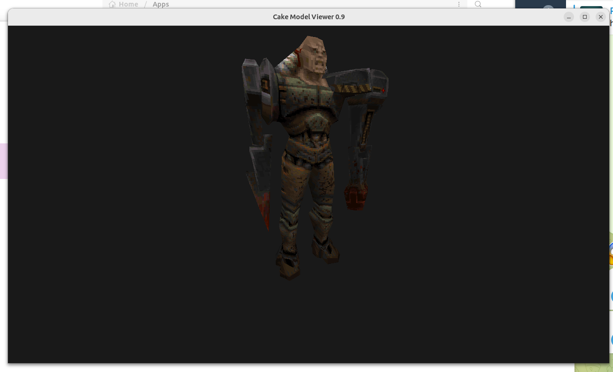
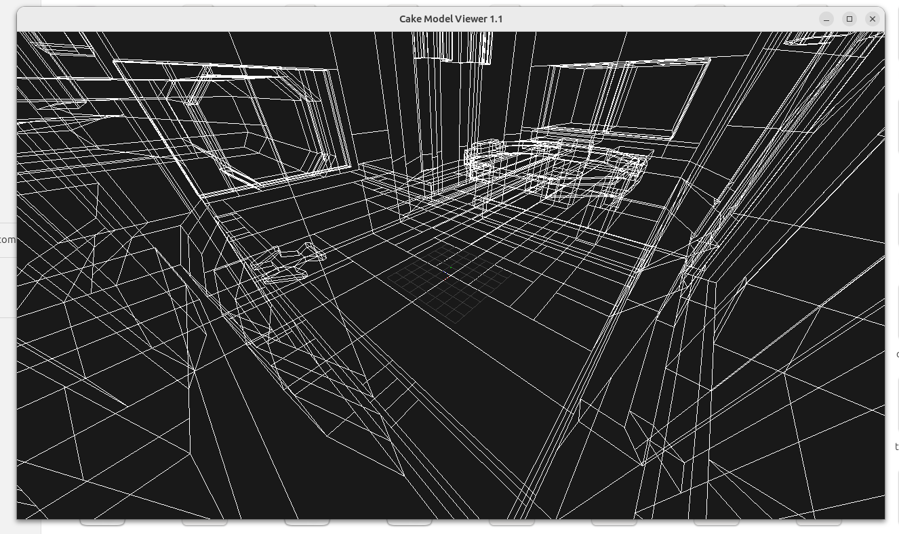

# Cake Viewer

View Quake II resources standalone, or open **Content browser** from the client/fullgame main menu.

## Open resources

- **Standalone:** pass a file or folder path at launch, or drop it onto the window; the first dropped path replaces the current view.
- **Client:** browse the active profile's resolved content, using its theme and `cl_ui_size`.
- Supported files: **PAK, PCX, WAL, TGA, WAV, SP2, MD2, BSP, CIN**, and text resources.

## Browser navigation

- Select a tree folder or double-click its tile to enter it; files show path and size, plus the winning source in the client.
- Image and first-frame CIN thumbnails load as they become visible; double-click a file for its full preview.
- **Back to folder** restores the grid and scroll position.
- **Escape:** close preview → parent folder → leave at root (close viewer / return to client menu).
- The client's top **Back** button returns directly to the menu; Escape closes loose-resource and empty standalone views directly.
- Changing selection/folders stops the previous playback; leaving a folder releases its thumbnails.
- Failed previews show an error; select or open another resource to recover.

## Folder browsing

Folders use the same browser and VFS indexing as profile content: recursive loose
files plus supported packages at the selected root, with the existing VFS precedence
and case-insensitive lookup. The listing and preview dependencies use the same VFS.
The folder is the game-data root; a `baseq2` folder works directly. Extracted model
folders also reuse sibling texture lookup and player-skin discovery. Empty folders
remain browsable with zero files. Reopen the folder to refresh its index.

```sh
./gradlew :cake:cake-viewer:run --args='/absolute/path/to/baseq2'
cake-viewer '/absolute/path/to/a folder' --capture /tmp/folder.png
```

This is read-only browsing; it does not select or modify a client profile.

## Previews and controls

Loose files, archive entries, and profile browsing use the same preview widgets;
their surrounding navigation and styling differ.

| Format | Behavior and controls |
| --- | --- |
| PCX / WAL / TGA | Aspect-fit preview; wheel zooms around the pointer, left-drag pans. Resize retains zoom/pan; reopening resets the fit. |
| Text | Read-only, wrapped and vertically scrollable UTF-8 text; tabs expand to four spaces. Supports CFG, TXT, LOG, INI, CSV, JSON, XML, MD, SHADER, ENT and LST. Files larger than 1 MiB show a labelled excerpt; configs are never executed. |
| CIN | Aspect-fit Quake II cinematic with audio at 14 fps. Streams from disk/archive; thumbnails decode only the first frame without audio playback. Opens paused; **Play / Pause / Stop**, **Space** toggles playback, **S** stops and returns to frame one. Play after completion restarts. |
| WAV | Click a tile to play once; double-click opens controls without restarting. **Space** pauses/resumes; **S** stops. Supports Quake II's 8-bit PCM WAVs. |
| SP2 | Click a tile to animate once; double-click opens controls without restarting. Frames stay centred on a fixed canvas; wheel zooms and left-drag pans. Playback runs at 10 fps. |
| MD2 | Loose files and browser entries share an automatically framed preview: left-drag orbits and wheel zooms. Shows frame names and a skin selector; generated skins are labelled **Default skin**. |
| BSP | Double-click to open; click the pane to focus, **WASD** flies, **Q/E** moves down/up, left-drag looks around. Click outside to release movement focus. |

- **Playback:** a shared bottom toolbar with one **Play/Pause** button and **Stop**; WAV/SP2/MD2 also offer a persistent **Loop** toggle, and sprites/models offer Previous/Next. Changing Loop does not start playback; Pause and Stop retain it.
- **Header:** filename and a brief summary. **Info** opens full resource metadata; **Help** opens shortcuts. Close either with Escape. Frame timing and permanent shortcut text no longer occupy preview space.
- **SP2/MD2 keyboard:** Space toggles playback; Left/Right step, pause and wrap. Stop resets to frame one; completed playback can restart.
- **Player skins:** `players/<model>/tris.md2` offers sibling PCX body skins, excluding icons, weapon, and disguise textures. A loose skinless `tris.md2` also works in an extracted folder. Skin changes retain camera/animation; missing skins use white fallback and failed selections keep the previous skin with an error message.
- **Loose files:** WAV plays on opening; SP2/MD2 start paused. BSP views start near a player spawn (or the map bounds when none exists); click the pane to fly. No grid or origin overlays.
- **BSP limits:** static world/brush geometry only; no collision, gameplay entities or sky. Trigger and area-portal brushes are hidden.
- Metadata includes image/frame dimensions, sound duration, model skin counts and map surface/brush counts.

## Run and build

- **IDE entrypoint:** `org.demoth.cake.lwjgl3.Lwjgl3ViewerLauncher.main` (optional file-path argument).
- **Desktop build:** `./gradlew :cake:cake-viewer:build`
- **Native build:** `./gradlew -PenableGraalNative=true :cake:cake-viewer:nativeCompile`
- **Native executable:** `cake/cake-viewer/build/native/nativeCompile/`

## CLI captures

Capture the complete Viewer UI to a PNG and exit:

```sh
./gradlew :cake:cake-viewer:run --args='/absolute/path/model.md2 --capture /tmp/model.png --size 1024x768'
```

The same options work with the packaged `bin/cake-viewer` executable. On this
machine, the installed `cake-viewer` terminal launcher forwards CLI options
directly to that executable; ordinary file opens use the GNOME desktop entry.

```sh
cake-viewer /absolute/path/model.md2 --capture /tmp/model.png
cake-viewer /absolute/path/pak0.pak --capture /tmp/archive.png --size 1440x900
cake-viewer --capture /tmp/empty.png
cake-viewer --help
```

- `--capture output.png` uses a hidden window, disables audio, writes after two
  completed draws, and exits. A working graphics context/display is still required.
- `--size WIDTHxHEIGHT` defaults to 1024×768 physical pixels. Output dimensions
  follow the framebuffer. Without capture, it sets the interactive window size.
- Animation time is held at zero during capture, so the initial preview is
  reproducible.
- Exit codes: 0 for success/help, 2 for invalid arguments, 1 for load/render/write
  failures. Capture failures propagate rather than silently capturing an error UI.
- Paths are relative to the process working directory; Gradle `run` uses
  `assets/`. Prefer absolute paths for automated runs. Quote paths with spaces;
  use `--` before a filename beginning with a dash.

This captures screen compositions for UI review. Asset-only thumbnails and OS
thumbnailer registration remain separate work. The existing screenshot writer
owns PNG output; the Viewer owns capture timing and exit behavior.

Verify argument handling and the hidden-window capture lifecycle:

```sh
CAKE_VIDEO_GL_TESTS=1 ./gradlew :cake:cake-viewer:test
```

A resource-type capture batch is available in
`assets/automation/capture-viewer-ui.py`. See the
[branding guide](../assets/cake-branding/README.md)
for the visual direction. Build the Viewer distribution first, then run:

```sh
python3 assets/automation/capture-viewer-ui.py --game-dir /path/to/quake2/baseq2 --cin /path/to/video/ntro.cin
```

The script requires Pillow, a working graphics context, and local game data
including `pak0.pak` and `players/male/tris.md2` with its skins. `--cin` is
optional; `--output` selects the capture directory. Game data and captures stay
under `build/`.

<details>
<summary>Linux: associate MD2 files with the native viewer</summary>

1. Create `~/.local/share/mime/packages/quake-md2.xml`:

```xml
<?xml version="1.0" encoding="UTF-8"?>
<mime-info xmlns="http://www.freedesktop.org/standards/shared-mime-info">
  <mime-type type="application/x-quake-md2">
    <comment>Quake II Model</comment>
    <glob pattern="*.md2"/>
  </mime-type>
</mime-info>
```

2. Create `~/.local/share/applications/cake-viewer.desktop`, replacing the executable path:

```ini
[Desktop Entry]
Version=1.0
Name=Cake Viewer
Exec=/path/to/the/executable %f
Icon=quake
Terminal=false
Type=Application
MimeType=application/x-quake-md2;
```

3. Refresh the databases and set the association:

```sh
update-mime-database ~/.local/share/mime
update-desktop-database ~/.local/share/applications
xdg-mime default cake-viewer.desktop application/x-quake-md2
```

</details>

<details>
<summary>Screenshots</summary>




</details>
