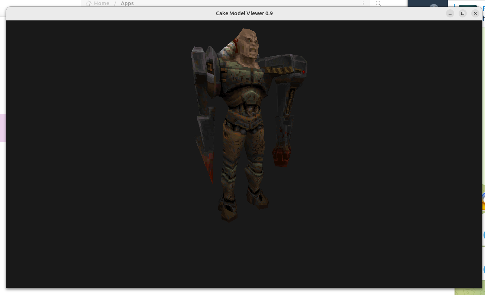
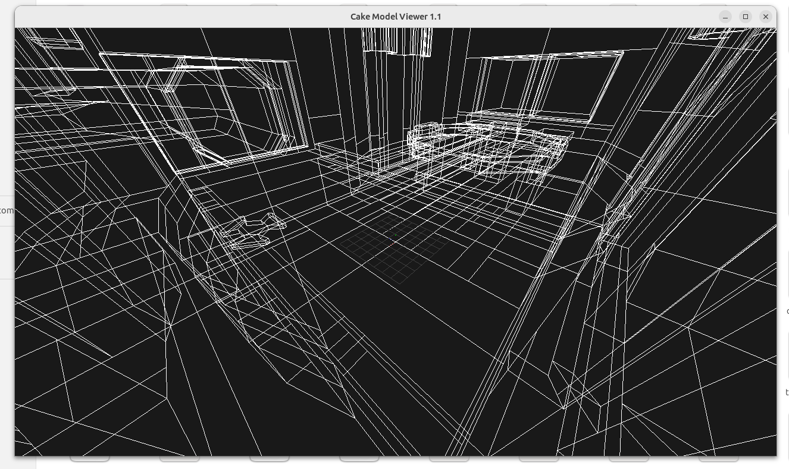

# Cake Viewer




This small app can display .md2, .bsp, .pcx, .wal, .tga and .sp2 files, play .wav
sounds, and browse .pak archives (provided as an argument).
It is part of the `cake` module and has its own LWJGL3 entrypoint.

Drop a resource file onto the viewer window to replace the current preview.
If several files are dropped, the first is opened. Switching stops sound playback
and resets animation and camera controls. Missing or unsupported files leave the
current preview open and show an error. A resource that fails during loading clears
the preview and shows an error; another file can still be dropped afterward.

PAK archives open a folder tree on the left and the selected folder's contents on
the right in a wrapping grid, sorted with folders first. Select a folder in the
tree or double-click its tile to browse it. Click a file to show its logical path
and size in bytes. Visible PCX, WAL and TGA tiles load image previews progressively;
unavailable images show a placeholder. Double-click an image for its original
pixel size, with scrolling for larger images. "Back to folder" restores the grid
and its scroll position. Loaded thumbnails stay available while scrolling in the
same folder and across full-preview/Back navigation. Leaving the folder or archive
releases them; there is no persistent thumbnail cache. Preview tiles use plain
images with a flat hover/selection highlight. Browsing reads archive metadata without extraction;
visible thumbnails and full previews materialize resources on demand. A failed
resource preview shows an error and reopens the archive at its root folder.

Click a WAV tile to play once while keeping the folder grid visible. Double-click
to show duration and Play/Loop/Stop controls without restarting playback. Play
restarts a single play, Loop starts repeated playback, and Stop ends either mode;
Space replays once and S stops. Selecting another tile, Back to folder, changing
folders, or opening another resource stops playback and unloads the sound.

### How to run
Run from IDE using `org.demoth.cake.lwjgl3.Lwjgl3ViewerLauncher.main` and pass a file path as the program argument.

### How to build
Build the viewer desktop app with `./gradlew :cake:cake-viewer:build`.

### Native build
Alternatively, you can build a native (so you have easier time to associate with the files in OS)
`./gradlew -PenableGraalNative=true :cake:cake-viewer:nativeCompile`
You will find the executable in `cake/cake-viewer/build/native/nativeCompile`

## List of features

- Renders `.md2` models with frame stepping and interpolated animation playback.
- Resolves referenced skins using the opened file's folder and parent, with detected
  game-data fallback and an adjacent-file fallback for game-relative skin paths.
  Models can render with a default skin when their referenced skins are missing.
- Renders `.bsp` maps and `.pcx` / `.wal` / `.tga` images.
- BSP previews reuse the engine world renderer for opaque and translucent world
  surfaces, with all surfaces enabled for free-flight inspection, static light
  styles at full intensity, and no gameplay dynamic lights.
- Displays `.sp2` sprites at each frame's declared dimensions, resolving
  referenced images through the same resource lookup as model skins.
- Plays `.wav` sounds, including Quake II's 8-bit PCM files.
- Uses the shared engine skin for a Scene2D information panel showing the filename,
  image dimensions, current/total SP2 frames with frame dimensions, MD2 frame
  and loaded skin texture counts (including the fallback texture when used),
  sound duration in seconds (or "unknown" when unavailable), and BSP world surface
  and inline brush model counts from the loaded render data.
- Displays a grid and axes for models and maps.

For MD2 models, press Space to toggle animation playback and Left/Right to step
frames. Press Escape to exit.

SP2 sprites start paused on the first frame. Press Space to play/pause the looping
animation at 10 frames per second, or Left/Right to step frames with wraparound.
SP2 files do not specify a playback rate. Controls are also shown in the window.

WAV files play once on opening. Press Space to replay, S to stop, and Escape to
close. These controls are also shown in the window.

## How to associate .md2 files with Cake Viewer?

### Linux instruction:

1. Create a new MIME type description file.
   Create a new file in the `~/.local/share/mime/packages` directory. 
   You can name it something like `quake-md2.xml.`:

```xml
<?xml version="1.0" encoding="UTF-8"?>
<mime-info xmlns="http://www.freedesktop.org/standards/shared-mime-info">
<mime-type type="application/x-quake-md2">
  <comment>Quake II Model</comment>
  <glob pattern="*.md2"/>
</mime-type>
</mime-info>
```

Then update database `update-mime-database ~/.local/share/mime`

2. Define the desktop entry in this file.
You can add an application file here `~/.local/share/applications/cake-viewer.desktop`:

```
 [Desktop Entry]
 Version=1.0
 Name=Cake Viewer
 Exec=/path/to/the/executable %f
 Icon=quake
 Terminal=false
 Type=Application
 MimeType=application/x-quake-md2
```
    
Then update database `update-desktop-database ~/.local/share/applications`

3. Associate the MIME Type with Your Application


Run `xdg-mime default cake-viewer.desktop application/x-quake-md2`
